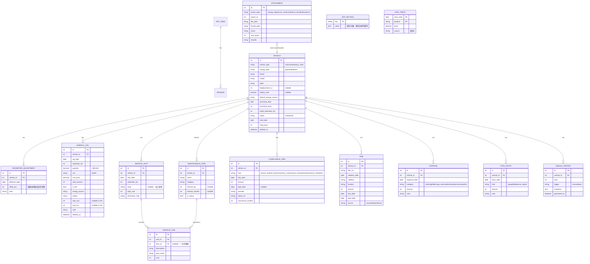

# MotoQ 系統設計（階段 2）

> 範圍已依確認結果調整：**無 OCR、無通知推播、無控制台整合、無賣車分享連結、無騎乘型態標記**；
> 新增電動車／電動機車支援。

## 1. 系統架構

```
 手機 PWA / 瀏覽器
        │  HTTPS（NAS 反向代理 → 公網）
        ▼
┌─────────────────── 單一 Docker 容器 ───────────────────┐
│  uvicorn（單 worker）                                  │
│  ┌──────────────┐   ┌─────────────────────────────┐   │
│  │ 靜態檔 (Vite) │   │ FastAPI  /api/v1/*          │   │
│  │  React PWA   │   │  routers → services → repos │   │
│  └──────────────┘   │  (SQLAlchemy 2.0 ORM)       │   │
│                     │  APScheduler（進程內）       │   │
│                     └──────────┬──────────────────┘   │
│                                │                       │
│              ┌─────────────────┴──────────┐            │
│              ▼                            ▼            │
│       SQLite (WAL)                 /data/uploads       │
│       /data/motoq.db               （壓縮後圖片）       │
└────────────────────────────────────────────────────────┘
        ▲ 備份腳本（host cron）：sqlite3 .backup + tar uploads → age 加密
```

### 設計原則
- **計算與儲存分離**：油耗、保養預測、到期狀態、年度成本一律由純函式即時計算（`app/domain/`），不存衍生值；pytest 直接測純函式。
- **無通知**：到期與保養提醒只在儀表板／列表以狀態徽章呈現（正常／即將到期／逾期）。
- **排程**（APScheduler，僅用於）：每年 12/31 自動產生年度報告、清理過期 session、（階段 4）抓取中油油價。
- **單一 worker**：避免 APScheduler 重複觸發，README 註明。
- **認證**：單一使用者，argon2 雜湊，httpOnly + SameSite=Strict cookie session；不開放註冊端點，帳號由 CLI 建立（`uv run python -m app.cli create-user`）；登入失敗限流。
- **圖片**：上傳後移除 EXIF、HEIC→JPEG、長邊縮至 1600px、品質 80、另產縮圖；檔名用 UUID，經認證端點讀取，不直接公開目錄。

### 後端目錄
```
backend/
  app/
    main.py            # FastAPI app、掛載靜態檔、lifespan 啟動排程
    config.py          # pydantic-settings 讀 .env
    db.py              # engine、WAL pragma、session
    models/            # SQLAlchemy models
    schemas/           # Pydantic I/O
    routers/           # auth vehicles energy maintenance compliance
                       # fines expenses etag attachments dashboard reports data
    services/          # 業務流程（含匯入匯出、圖片處理、PDF）
    domain/            # 純函式：efficiency.py maintenance.py compliance.py costs.py
    scheduler.py
    cli.py
  alembic/
  tests/
frontend/
  src/{pages,components,api,hooks,lib}/
deploy/  docker-compose.yml  Dockerfile  .env.example  backup.sh
docs/
```

## 2. 電動車支援設計

| 面向 | 做法 |
|---|---|
| 車輛 | `energy_type`：`gasoline` / `electric`（油電混合歸 gasoline）；電動車額外有 `battery_kwh`（選填） |
| 能源記錄 | 加油與充電共用 `energy_logs`，以 `unit`（L / kWh）區分，`energy_source` 區分來源 |
| 來源 | 油：`gas_92/95/98/diesel`；電：`home`、`public_ac`、`public_dc`、`swap`（換電，如 Gogoro） |
| 效率 | 油：km/L；電：km/kWh（與每公里電費）。同樣採「充滿到充滿」；若填了起訖電量 %，單筆即可估算，不必等下一次充滿 |
| 訂閱制 | 換電月租等以 `expenses`（category=`energy_subscription`）記錄，年度報告計入「能源」類 |
| 保養範本 | 電動車範本無機油／空濾／火星塞，改為 煞車油、齒輪油、輪胎、電瓶健康檢查 |
| 快速輸入 | 表單依車輛 energy_type 自動切換欄位（公升↔度數、油品↔充電方式） |

## 3. ER 圖



### 關鍵規則
- **總里程** = 記錄上的儀表讀數 + 該日期以前所有 `odometer_adjustment.offset_km` 之和。
- **金額**：TWD 整數；`unit_price` 與 `quantity` 用 Decimal；`total_amount` 允許使用者輸入值（發票為準），與 單價×數量 差異於 ±1 元內不警告。
- **保養狀態**：`maintenance_item` 的「上次更換」= 該 item 最新一筆 `service_line` 所屬 visit 的日期與里程；到期日 = min(上次日期 + interval_months, 預測達到 上次里程 + interval_km 的日期)。
- **持有成本**分類：能源（energy_logs + energy_subscription）、保養（service_visits）、稅費與保險（compliance_items 已繳）、罰單（fines）、其他（expenses）；每公里成本 = 區間總成本 ÷ 區間行駛里程。
- **軟刪除**：`deleted_at`；匯入前自動快照 DB。

## 4. API 清單（`/api/v1`）

| 群組 | 端點 |
|---|---|
| 認證 | `POST /auth/login` · `POST /auth/logout` · `GET /auth/me` · `POST /auth/change-password` |
| 車輛 | `GET,POST /vehicles` · `GET,PATCH,DELETE /vehicles/{id}` · `POST /vehicles/{id}/odometer-adjustments` · `POST /vehicles/{id}/apply-template`（套用保養範本） |
| 能源記錄 | `GET,POST /vehicles/{id}/energy-logs` · `PATCH,DELETE /energy-logs/{id}` · `GET /vehicles/{id}/energy-logs/defaults`（快速輸入預填） |
| 油耗／電耗 | `GET /vehicles/{id}/efficiency/stats?from&to` · `GET /vehicles/{id}/efficiency/trend` · 含異常下降警示旗標 |
| 保養項目 | `GET,POST /vehicles/{id}/maintenance-items` · `PATCH,DELETE /maintenance-items/{id}` · `GET /vehicles/{id}/maintenance/status`（倒數與預測）· `GET /maintenance-templates` |
| 維修履歷 | `GET,POST /vehicles/{id}/service-visits` · `GET,PATCH,DELETE /service-visits/{id}` |
| 稅費到期 | `GET,POST /vehicles/{id}/compliance` · `PATCH,DELETE /compliance/{id}` · `POST /compliance/{id}/pay` · `POST /compliance/{id}/renew`（產生下一期）· `GET /compliance/upcoming` |
| 罰單 | `GET,POST /vehicles/{id}/fines` · `PATCH,DELETE /fines/{id}` · `POST /fines/import`（CSV）· `POST /fines/lookup`（Provider 介面，MVP 為 Mock） |
| 其他支出 | `GET,POST /vehicles/{id}/expenses` · `PATCH,DELETE /expenses/{id}` |
| etag | `GET,POST /vehicles/{id}/etag` · `DELETE /etag/{id}` · `GET /vehicles/{id}/etag/balance` |
| 附件 | `POST /attachments`（multipart）· `GET /attachments/{id}/file` · `GET /attachments/{id}/thumb` · `DELETE /attachments/{id}` |
| 儀表板 | `GET /dashboard`（全部車輛概覽）· `GET /vehicles/{id}/dashboard` |
| 報表 | `GET /vehicles/{id}/reports/annual?year` · `POST /vehicles/{id}/reports/annual` · `GET /vehicles/{id}/reports/service-history.pdf` · `GET /reports/compare?vehicle_ids&from&to` |
| 資料 | `GET /data/export?format=json\|csv` · `POST /data/import?dry_run=true` · `GET,PUT /settings` |
| 油價（階段 4） | `GET /fuel-prices/latest` · `GET /fuel-prices/history` |
| 系統 | `GET /healthz` |

## 5. 階段規劃（修訂）

| 階段 | 內容 |
|---|---|
| 3 MVP | 專案骨架、Docker、認證、車輛 CRUD、油／電記錄（含快速輸入）、效率計算與趨勢圖、儀表板基礎、匯出入、pytest（油耗計算） |
| 4 | 保養項目／範本／預測、稅費到期狀態、罰單／停車／etag、pytest（保養預測、到期邏輯） |
| 5 | 附件上傳（EXIF 移除、壓縮）、維修履歷 PDF、年度報告與兩車比較、備份腳本 |
| 6 | 中油油價比較（儀表板內顯示，無推播）、收尾與文件 |

---

## 6. 最終版變更摘要（v1.0）

- **能源類型**新增 `hybrid`（油電，僅限汽車）：km/L 只用加油記錄，充電費用計入成本。
- **多使用者**：`app_users` 增加 `role`（admin/user）與 `status`（active/pending/disabled）；`vehicles.user_id` 為資料擁有者，
  所有子資料經由車輛隔離。第一位註冊者自動為管理員；註冊模式（關閉／核准／開放）與登入限流等為全站設定（`app_settings`）。
- **稽核**：`security_events` 記錄登入、註冊、密碼變更、管理動作與資料匯入；`auth_sessions` 記錄 IP 與 user agent，管理員可登出任一工作階段。
- **個人設定**：`user_settings`（異常門檻、到期提前天數）；匯出入以使用者為範圍，匯入時主鍵重新配發。
- **取消**：OCR、通知推播、控制台整合、Google 日曆、賣車分享連結、騎乘型態標記。
- **新增 API 群組**：`/admin/*`、`/auth/register`、`/auth/registration`、`/attention`、`/fuel-prices/*`、`/vehicles/{id}/reports/*`。
